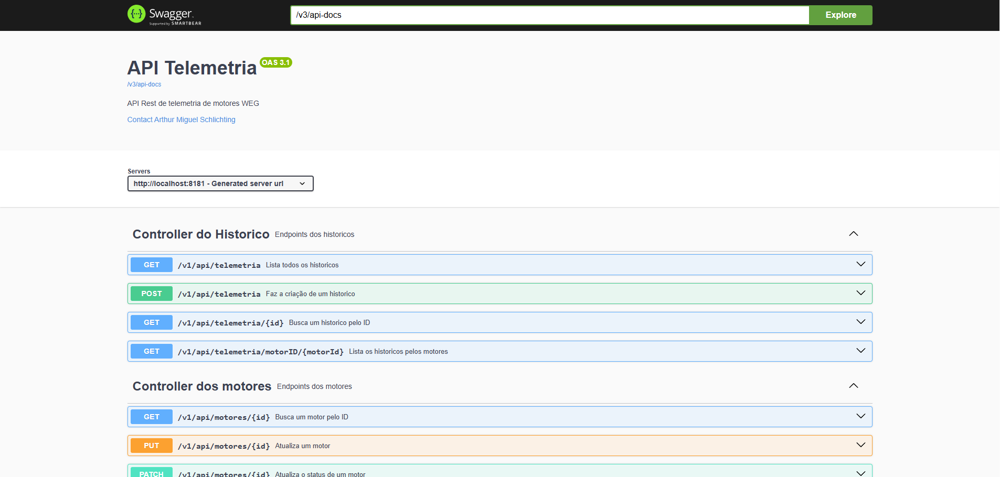

**API Telemetria**
----

## Contextualização:

> A empresa está desenvolvendo o backend do projeto API de Telemetria
Industrial, responsável pelo monitoramento de motores e emissão de alertas em tempo real.
O projeto foi repassado à sua equipe após a saída do desenvolvedor anterior. Ao executar a aplicação
e consultar as equipes de Frontend e Suporte/Sustentação, foram relatados os seguintes problemas no
estado atual do sistema:
>* Integração bloqueada: A equipe de Frontend não consegue consumir a API nem realizar testes, pois
não há uma especificação acessível dos endpoints, parâmetros, formatos de requisição (payloads) ou
respostas HTTP esperadas.
>* Comportamento inoperante: As requisições enviadas para as rotas da aplicação retornam erros ou
respostas vazias/não implementadas.
>* Dificuldade de manutenção: A equipe interna não consegue identificar as regras de negócio aplicadas
nas camadas de serviço devido à ausência de documentação do código-fonte

### Justificativas de Escolhas:

> Após analisar o código completo, onde veio apenas com as classes Controllers faltando
> e sem a documentação, eu decidi adotar uma estratégia de ir fazendo um CRUD por fez
> lendo de acordo com o fluxo **Git Flow** para conseguir assim me organizar melhor
> e não acabar me perdendo. 
> A sequência que eu segui foi:
> * **Entity** -> **DTO** -> **Mapper** -> **Repository** -> **Service** ->
> **Controller**
> ---
> Enquanto eu ia lendo as classes, eu ia documentando com **JavaDoc**, eu fiz isso 
> nas classes **Entity**, **DTO**, **Mapper**, **Repository** e a **GlobalExceptionHandler**.
> Eu utilizei o Swagger apenas para fazer os **@Schemas**, para quem leia meu código
> consiga entender como ele está no banco de dado.
> ---
> A utilização do Swagger no controller é por conta que nele iram ir os **Endpoints**,
> onde a API realmente vai consumir do banco de dados, a documentação é feita com o 
> swagger, utilizando @Operation, @ApiResponse, onde fazendo isso irá automaticamente 
> para a documentação do swagger para que fique muito mais intuitivo e mais fácil de entender como e de que jeito a API consome o banco de dados
> --- 
> A documentação do swagger fica assim, com os endpoints já documentados
>
> ---
> Esse nome e informações de contato, vem do **OpenApiConfig**, que é onde nós configuramos
> as informações que ficaram no header da documentação.
> ---
> Exemplo de código: 
> ```java
>   @Configuration
> public class OpenApiConfig {
> 
>    @Bean
>    public OpenAPI customApi(){
>        return new OpenAPI().info(new Info()
>                .title("API Telemetria")
>                .description("API Rest de telemetria de motores WEG")
>                .contact(new Contact()
>                        .name("Arthur Miguel Schlichting")
>                        .email("arthums2904@gmail.com")));
>    }
> ```
> Ela fica dentro da pasta **Config**, que é onde ficam as configurações gerais do código
> nesse trabalho foi para configurar as informações da API.
> 
> ### Feito por Arthur Miguel Schlichting